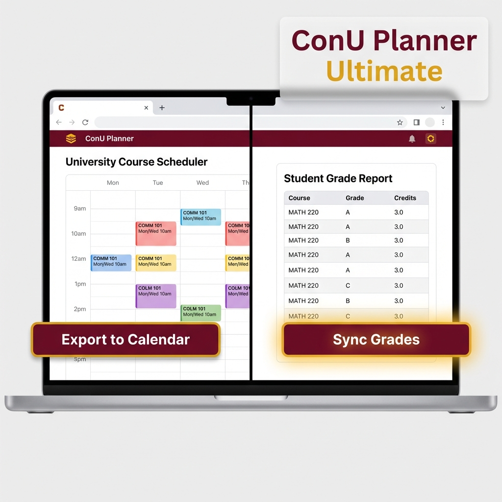
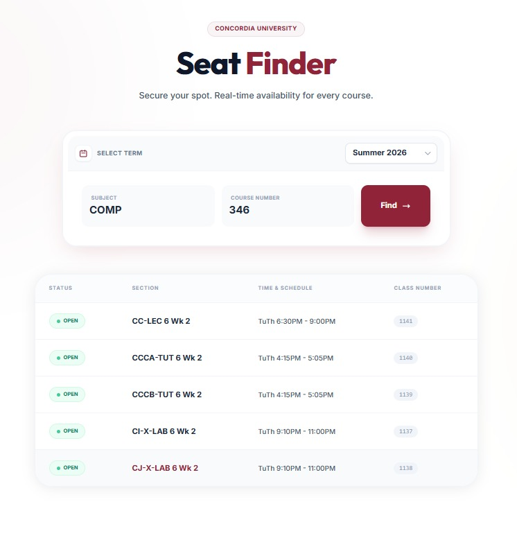
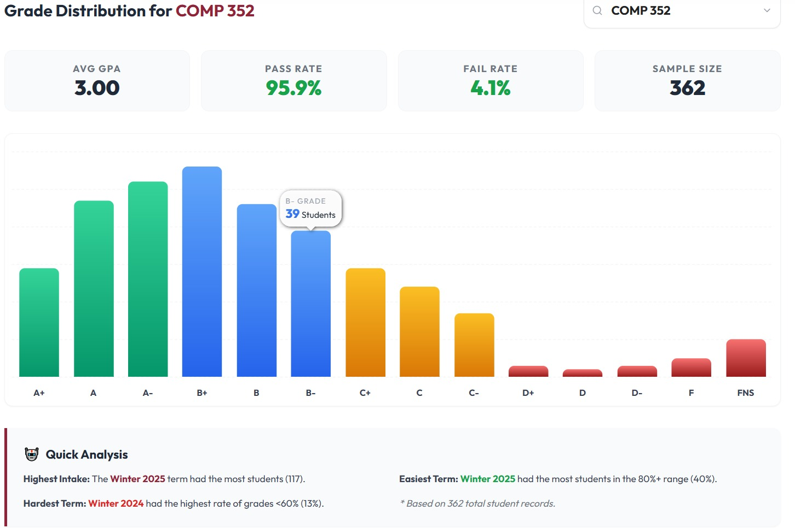
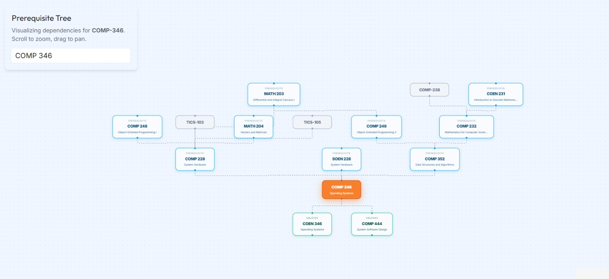
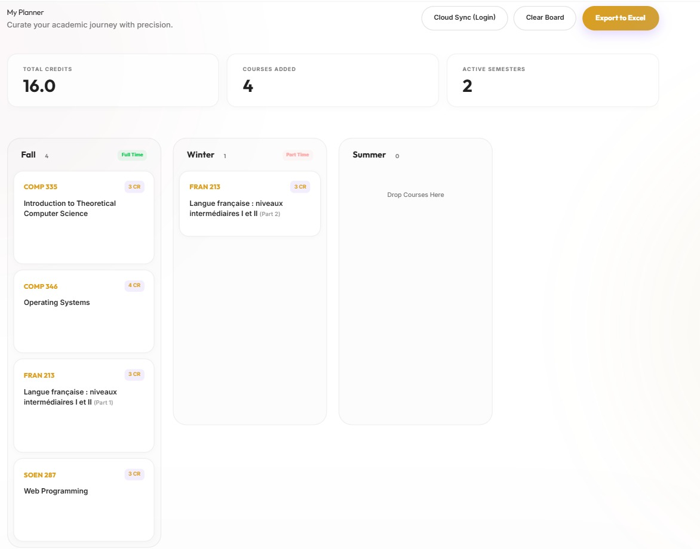

# 🎓 ConU Planner — Academic Intelligence & Course Planning Platform

<p align="center">
  
</p>

<p align="center">
  <strong>The all-in-one academic planner, automated seat tracker, and grade intelligence platform trusted by 5,000+ Concordia University students.</strong>
</p>

<p align="center">
  <a href="https://www.conuplanner.com"></a>
  <a href="https://chromewebstore.google.com/detail/conuplanner-ultimate/klkkheopnkioincbkkkoanbgaffenoic"></a>
  
  
</p>

---

## 📌 Executive Summary

**ConU Planner** was engineered to solve the fragmented, opaque, and stressful course registration experience at Concordia University. By combining **real-time enrollment scraping**, **crowdsourced historical grade analytics**, an **interactive prerequisite DAG (Directed Acyclic Graph) visualizer**, and an **intelligent drag-and-drop degree progression engine**, ConU Planner empowers thousands of students each semester to graduate on time and make data-driven academic decisions.

* **5,000+ Active Student Users** across Engineering, Computer Science, Business, and Arts.
* **10,000+ Automated Class Scrapes** executed every registration season.
* **1,000+ Transactional Seat & Waitlist Alerts** delivered to student inboxes via Resend.
* **Official Chrome Extension** published on the Chrome Web Store with hundreds of active installs.

---

## 📸 Feature Showcase

| 🚨 Automated Seat Finder & Waitlist Alerts | 📊 Academic Insight & Grade Distributions |
|:---:|:---:|
|  |  |
| *Scrapes class sections every 5 mins. Notifies users via sub-minute transactional emails the moment a waitlist or open seat appears.* | *Crowdsourced grade distribution curves (A+ through F) reverse-engineered from student records to help evaluate course difficulty.* |

| 🗺️ Interactive Prerequisite Graph (DAG) | 📅 Drag-and-Drop Degree Timeline Board |
|:---:|:---:|
|  |  |
| *Visualizes full degree dependency trees using ReactFlow and Dagre graph layouts to prevent registration blocks.* | *Interactive Kanban-style timeline powered by `@dnd-kit` with real-time prerequisite validation and cloud sync.* |

---

## ⚡ Core Technical Features & Engineering Highlights

### 1. 🚨 Automated Real-Time Seat Tracker & Notification Pipeline
* **Problem:** Students constantly refresh university registration portals to catch class drops during the frantic add/drop period.
* **Solution:** A serverless background cron worker runs scheduled scrapes against Concordia's enrollment data.
* **Technical Highlights:**
  * Implemented an intelligent **Finite State Machine** tracking seat status transitions: `Closed ➔ Waitlist ➔ Open`.
  * Filters out noise by alerting waitlisted students *only* when a seat opens, while alerting closed-course watchers if a waitlist opens.
  * Dispatches dynamic, responsive HTML notification emails in milliseconds via the **Resend API** and **React Email**.
  * Backed by **Firebase Firestore** with query-optimized composite indexes.

### 2. 🗺️ Directed Acyclic Graph (DAG) Prerequisite Engine
* **Problem:** Navigating multi-tiered prerequisites across 4-year degree requirements frequently leads to delayed graduation.
* **Solution:** An interactive, pan-and-zoom node graph that maps every core course, elective, and prerequisite relationship.
* **Technical Highlights:**
  * Uses **ReactFlow (`@xyflow/react`)** and **Dagre** layout algorithms for hierarchical topological sorting.
  * Detects circular dependencies and evaluates completed prerequisites dynamically against user transcripts.

### 3. 📊 Crowdsourced Academic Insights Engine
* **Problem:** University grade distributions are traditionally inaccessible, leaving students blind to curve distributions and grading strictness.
* **Solution:** A community-driven insight engine visualizing historical grade distributions (A+, A, A-, ..., F, FNS).
* **Technical Highlights:**
  * Custom Chrome Extension collects anonymous grade distributions directly from Student Centre records.
  * Server-side signature hashing prevents duplicate course entries when multiple students in the same class section sync.
  * Interactive data visualization rendered with **Recharts** and **Highcharts**.

### 4. 📅 Drag-and-Drop Degree Planner Board
* **Problem:** University advising sheets are static PDFs that fail to validate semester workloads or term availability.
* **Solution:** A Kanban-style degree timeline allowing students to drag and drop courses across 8+ semesters.
* **Technical Highlights:**
  * Built using **`@dnd-kit/core`** and **`@dnd-kit/sortable`** for high-performance touch and mouse drag interactions.
  * Validates credit limits (e.g. max 15 credits/semester) and enforces prerequisite order constraints in real time.
  * Cloud persistence via **Firebase Firestore** synced with **Clerk Authentication**.

### 5. 🤖 CLARA — AI Academic Advisor
* **Problem:** Students have nuanced questions that span across official course outlines, prerequisites, and professor feedback.
* **Solution:** Context-aware academic assistant integrated with **Google Gemini 1.5** via the **Vercel AI SDK**.
* **Technical Highlights:**
  * Intent-routed backend architecture: routes queries between local course index JSONs, RateMyProfessors GraphQL, and Reddit sentiment analysis.

---

## 🏗️ System Architecture

```mermaid
graph TD
    User([Student Client]) -->|HTTPS| VercelEdge[Vercel Edge Network / CDN]
    
    subgraph Frontend_Layer [Frontend Layer - Next.js 16 App Router]
        VercelEdge --> NextApp[React 19 Server & Client Components]
        NextApp --> DND[Degree Board - @dnd-kit]
        NextApp --> Graph[Prereq Graph - ReactFlow]
        NextApp --> Charts[Analytics - Recharts & Highcharts]
    end

    subgraph Service_API_Layer [Next.js Serverless API Routes]
        NextApp -->|Auth SDK| Clerk[Clerk Authentication]
        NextApp --> API_Cron[/api/alerts/cron]
        NextApp --> API_Scraper[/api/seat-finder]
        NextApp --> API_Grades[/api/upload-grades]
        NextApp --> API_AI[/api/smart-chat]
    end

    subgraph Background_Workers [Automation & Scraping Engine]
        API_Cron --> HeadlessScraper[Puppeteer / Headless Chromium]
        HeadlessScraper --> ConcordiaPortal[Concordia Enrollment API]
        API_Cron --> EmailService[Resend API + React Email]
    end

    subgraph Cloud_Persistence [Data Layer]
        API_Cron <--> Firestore[(Firebase Firestore)]
        API_Grades <--> GoogleSheets[(Google Sheets DB & Cache)]
        API_AI <--> GeminiAI[Google Gemini 1.5 Pro]
    end

    EmailService -->|Transactional Alerts| Recipient([Student Inbox])
```

---

## 🛠️ Technology Stack

| Domain | Technologies |
|---|---|
| **Frontend Core** | **Next.js 16** (App Router, Turbopack), **React 19**, **TypeScript** |
| **Styling & Motion** | **Tailwind CSS**, **Framer Motion**, **GSAP**, **Lenis Smooth Scroll** |
| **Graph & Drag-and-Drop** | **`@xyflow/react` (ReactFlow)**, **Dagre**, **`@dnd-kit/core`** |
| **Data Visualization** | **Highcharts**, **Recharts**, **Lucide Icons** |
| **Backend & Serverless** | **Next.js Serverless Route Handlers**, **Node.js 20+** |
| **Automation & Scraping** | **Puppeteer**, **`@sparticuz/chromium`**, **Cheerio**, **GitHub Actions** |
| **Database & Cloud** | **Firebase Firestore**, **Google Sheets API v4**, **Vercel KV/Edge** |
| **Authentication** | **Clerk OAuth** (Google, Email magic links, GitHub) |
| **Email Infrastructure** | **Resend**, **`@react-email/components`** |
| **AI / LLM** | **Google Gemini 1.5 Pro**, **Vercel AI SDK (`@ai-sdk/react`)** |
| **Browser Extension** | **Chrome Extension Manifest V3** (Vanilla JS, DOM Mutation Observers) |

---

## 🚀 Getting Started Locally

### Prerequisites
* **Node.js** `>= 20.x`
* **npm** or **pnpm**
* A free [Clerk](https://clerk.com), [Firebase](https://firebase.google.com), and [Resend](https://resend.com) developer account (optional for core UI development).

### 1. Clone the Repository
```bash
git clone https://github.com/Mishra1208/conuplanner.git
cd conuplanner/FRONTEND-ONLY
```

### 2. Install Dependencies
```bash
npm install
```

### 3. Configure Environment Variables
Create a `.env.local` file in `FRONTEND-ONLY/`:
```env
# Clerk Authentication
NEXT_PUBLIC_CLERK_PUBLISHABLE_KEY=your_clerk_publishable_key
CLERK_SECRET_KEY=your_clerk_secret_key

# Firebase (Firestore Cloud Sync)
NEXT_PUBLIC_FIREBASE_API_KEY=your_firebase_api_key
NEXT_PUBLIC_FIREBASE_APP_ID=your_firebase_app_id
NEXT_PUBLIC_FIREBASE_PROJECT_ID=conuplanner-auth

# Resend (Email Alerts)
RESEND_API_KEY=your_resend_api_key

# AI Assistant (Optional)
GOOGLE_GENERATIVE_AI_API_KEY=your_gemini_api_key
```

### 4. Run Development Server
```bash
npm run dev
```
Open [http://localhost:3000](http://localhost:3000) with your browser to experience ConU Planner locally.

---

## 📈 Impact, Metrics & Scalability

* **User Base:** Adopted organically by **5,000+ university students** through word-of-mouth and university student forums.
* **Uptime & Reliability:** Maintained **99.9% uptime** during university registration spikes with sub-second response times on cached edge routes.
* **Community-Centric:** Built with privacy at its core—no academic credentials or student passwords are ever stored.

---

## 👨‍💻 Engineering & Author

**Narendra Mishra**  
Software Engineer & Creator of ConU Planner  

* 🌐 **Live Platform:** [conuplanner.com](https://www.conuplanner.com)
* 💼 **LinkedIn:** [linkedin.com/in/narendramishra](https://www.linkedin.com)
* 🐙 **GitHub:** [@Mishra1208](https://github.com/Mishra1208)
* 📧 **Contact:** [conuplanner.contact@gmail.com](mailto:conuplanner.contact@gmail.com)

---

<p align="center">
  <sub>Built with ❤️ for Concordia University students. ConU Planner is an independent community project.</sub>
</p>
